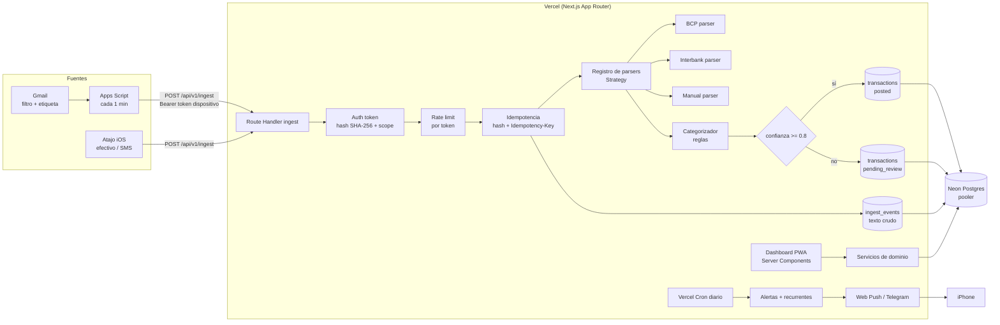

# Ciclo — Arquitectura

## Decisiones cerradas (respuestas del paso 1)

| Tema | Decisión |
|---|---|
| País / zona horaria | Perú, `America/Lima` (UTC−5, sin horario de verano) |
| Monedas | PEN principal; USD habilitado como opción en cuentas, efectivo y tarjeta |
| Sueldo | Mensual, S/ 1,320, llega el 27–28 a **BCP**, palabra clave `PLANILLA`. Si cae en fin de semana/feriado, se adelanta |
| Ingresos variables | Frecuentes (casi diarios), categoría propia |
| Tarjeta | **Interbank Visa Clásica**, bimoneda (PEN + USD), corte día 26, pago día 20 del mes siguiente, si el pago cae en no hábil se adelanta 1 día |
| Cuotas | Con interés (TEA según perfil; referencia pública 19.42%–87.76% en soles) → se modela TEA por plan de cuotas |
| Fuente de movimientos | **Correo** (no SMS) |
| BD / Auth | Neon (rama por preview) + Auth.js con passkeys |
| Visual | Sistema oscuro del DESIGN.md (tokens, no marca) + modo claro derivado; fuentes libres |
| Alertas | Web Push de la PWA (principal) + bot de Telegram opcional para urgentes |
| Multimoneda | Ambas vistas: por moneda separada **y** consolidado en PEN con tipo de cambio (manual al inicio, API después) |

## Cambio importante: el correo no se lee desde el iPhone

La automatización "Correo" de Atajos solo se activa cuando **la app Mail de Apple** descarga el mensaje. Con Gmail dentro de Apple Mail no hay push, solo *fetch* cada 15 min, cada hora o manual, y en segundo plano iOS lo retrasa aún más. Además, en algunas versiones pide confirmación. Para un objetivo Zero-Manual-Entry eso no es confiable.

**Propuesta:** leer el correo en el servidor y no en el teléfono.

- **Si usas Gmail:** un filtro de Gmail pone la etiqueta `ciclo/banco` a los correos de BCP e Interbank. Un **Google Apps Script** gratuito, con su propio token, revisa esa etiqueta cada minuto y hace `POST /api/v1/ingest` con `source: "email"`. Funciona aunque el iPhone esté apagado.
- **Si usas Outlook/Hotmail:** lo mismo con Power Automate (el flujo gratuito "Cuando llega un correo").
- **El iPhone queda para:** el Atajo de efectivo (2 toques) y, opcionalmente, la automatización de SMS si algún banco la necesita.

El endpoint no cambia: siempre recibe texto crudo. El "cliente" que lo llama es lo único que varía.

## Diagrama

## Decisiones clave

1. **El parsing se hace en el servidor y guarda el texto crudo.** Un parser mejorado puede reprocesar `ingest_events` antiguos sin tocar el cliente. Cada parser tiene `id` y `version`, y cada evento guarda qué versión lo procesó.
2. **El libro contable es una sola tabla, `transactions`, con signo relativo a la cuenta.** Negativo es salida y positivo es entrada. Las transferencias y los pagos de tarjeta son **dos transacciones enlazadas por `transfers`** y su `kind` las excluye de ingresos y gastos. Así se evita el doble conteo sin casos especiales.
3. **La tarjeta bimoneda es una `credit_card` con dos `accounts` (PEN y USD).** Se mantiene la regla "cada cuenta tiene una sola moneda", y saldos y sumas nunca mezclan monedas. La línea de crédito es única y se guarda en PEN. La línea disponible se calcula como `límite − deuda PEN − deuda USD × TC`.
4. **Ciclo de facturación híbrido.** Las fechas de corte y de pago se **calculan** con una función pura: configuración de la tarjeta + calendario de feriados de Perú (`holidays`). Los **montos reales** del estado de cuenta (total, mínimo) se guardan en `card_statements` cuando llega el correo del estado de cuenta o los ingresas tú. Sin ese dato, el monto se estima sumando las transacciones del ciclo. Esto es necesario porque el banco agrega intereses y comisiones que no se pueden predecir con exactitud.
5. **Las cuotas con interés usan el sistema francés con TEA → TEM.** `TEM = (1+TEA)^(1/12) − 1` y `cuota = P·TEM / (1 − (1+TEM)^−n)`. Es una aproximación, porque Interbank calcula intereses diarios. Si el correo o el estado de cuenta trae el monto real de la cuota, ese valor reemplaza al calculado (`installments.amount_minor_actual`).
6. **El nivel de confianza va de 0 a 1 y lo da cada parser.** Bajan la confianza: que falte el monto, la moneda o la cuenta, que el remitente no coincida con el banco esperado, o que el patrón sea genérico. Con un valor menor a 0.8 la transacción queda `pending_review` y no cuenta en los totales hasta que la apruebes.
7. **Idempotencia en dos niveles.** El primero es `content_hash = sha256(normalizar(raw_text) + sender + received_at redondeado al minuto)`, con restricción única por usuario. El segundo, opcional, es la cabecera `Idempotency-Key`, también única. Un duplicado devuelve `200` con el resultado original, no un error, para que el cliente no reintente.
8. **Sin HMAC en el MVP.** Atajos no puede calcular HMAC sin trucos frágiles. Apps Script sí puede (`Utilities.computeHmacSha256Signature`). El esquema queda así: Bearer por dispositivo + HTTPS + idempotencia + rate limit. Para Apps Script, en v1 se agrega una firma `X-Ciclo-Signature: t=<ts>,v1=<hmac>` opcional, con una ventana de 5 min. El token de Atajos tiene scope `ingest:manual`: solo puede registrar efectivo, no reclamar movimientos bancarios.
9. **Multiusuario desde el día 1.** Todas las tablas llevan `user_id` y todos los repositorios lo reciben de forma obligatoria (no existe una consulta sin `userId`). No uso RLS porque Neon con Auth.js no lo necesita. El filtrado se fuerza en la capa de repositorios.
10. **Respuesta en menos de 500 ms.** El ingest hace una sola transacción SQL a través del driver WebSocket de Neon (`@neondatabase/serverless` con `Pool`). Es necesario porque el driver HTTP no admite transacciones interactivas, y el Pool se reutiliza entre invocaciones calientes. Las tareas que no son críticas (detectar recurrentes, alertas de gasto inusual) se dejan para el cron diario.

## Riesgos y limitaciones reales

- **Formatos de correo:** los bancos los cambian sin avisar. Para mitigarlo: el texto crudo se guarda siempre, hay bandeja de revisión y tests con ejemplos reales. Si un parser falla, el evento queda como `failed` y se puede ver en la app; no se pierde.
- **Yape:** si tus ingresos diarios llegan por Yape, Yape avisa con notificaciones push, que Atajos no puede leer, y normalmente no manda correo por cada abono. Esos ingresos podrían no entrar solos (ver pregunta pendiente).
- **Cuotas e intereses:** son estimados hasta que llega el estado de cuenta real.
- **Web Push en iOS:** requiere la PWA instalada en la pantalla de inicio (iOS 16.4 o superior), y la suscripción puede caducar. Por eso existe Telegram como respaldo.
- **Vercel Hobby:** los cron jobs se ejecutan como máximo 1 vez al día y la hora exacta no está garantizada (pueden variar dentro de la hora). Es suficiente para recordatorios con días de anticipación.
- **Apps Script:** tiene una cuota de unas 20,000 llamadas `UrlFetch` al día en cuentas gratuitas. Revisar cada minuto son 1,440 ejecuciones y solo se hace un POST si hay correos nuevos. Hay margen de sobra.
